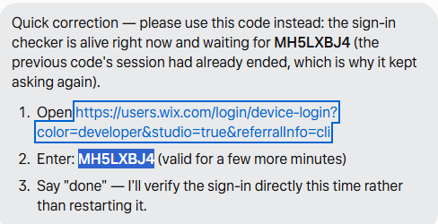

# Asif SaaS Studio — Wix Headless Project

The official brand logo (gold serif "A" monogram with code brackets and a graduation cap on
deep green, with the "ASIF SAAS STUDIO" wordmark) lives at `public/asif-saas-studio-logo.png`.
It is wired in as the header logo and favicon in `src/layouts/SiteLayout.astro` (and as the
favicon in `src/layouts/Layout.astro`). Do not redesign or recolor it.

**Site:** the tools catalogue at https://headless-pmvjliowzro-ftonlineclass-140d.wix-site-host.com
(siteId `f421df5e-3506-42e9-ba09-74510e5e2b2c`, see `wix.config.json`).

**Features configured:** Wix CMS only — the shipped CMS data layer (`src/wix/cms/`, hooks in
`src/hooks/cms/`) reads the live `SaasProducts` collection (title, slug, summary, category,
appHtml, appUrl, published, demo, version). No stores, bookings, events, members, payments or
pricing plans are enabled. Nothing has been released from this folder: the live frontend was
released separately (2026-10-20) and a `wix release` from here would replace it — release only
on the owner's explicit instruction.

---

# Wix Astro Blank Template

Our Astro templates are still in development and subject to change.

To use a template, follow the [Wix CLI for Headless Quick Start](https://dev.wix.com/docs/go-headless/develop-your-project/wix-managed-headless/get-started/quick-start), and select the desired template during the setup process.

## Need help?

For documentation and support, check out:

- [Wix Headless Documentation](https://dev.wix.com/docs/go-headless)
- [Wix SDK Documentation](https://dev.wix.com/docs/sdk)
- [Community on Discord](https://discord.gg/n6TBrSnYTp)